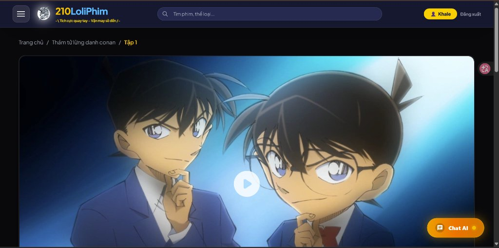
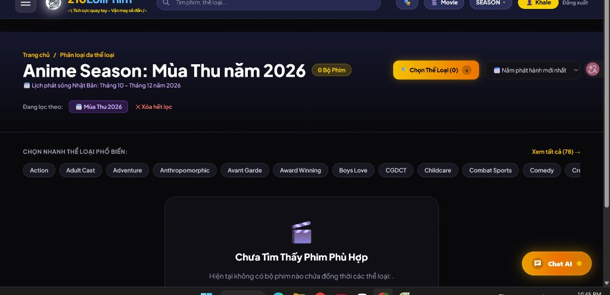
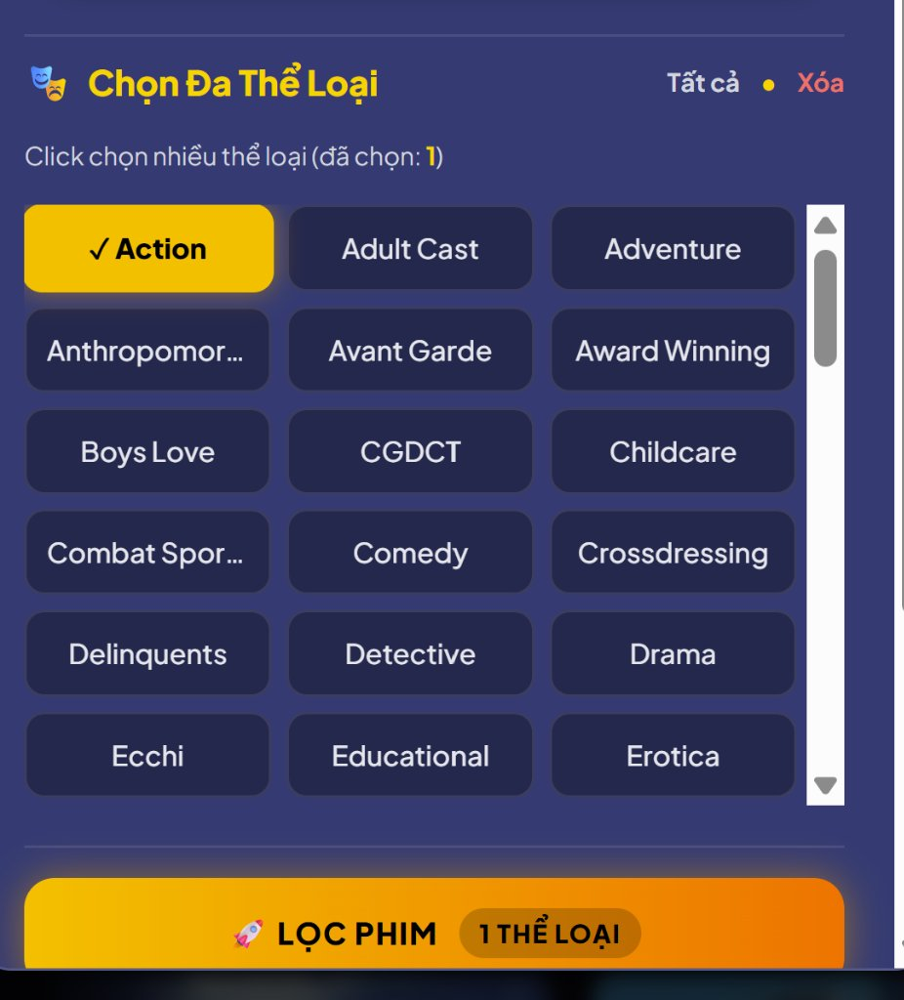
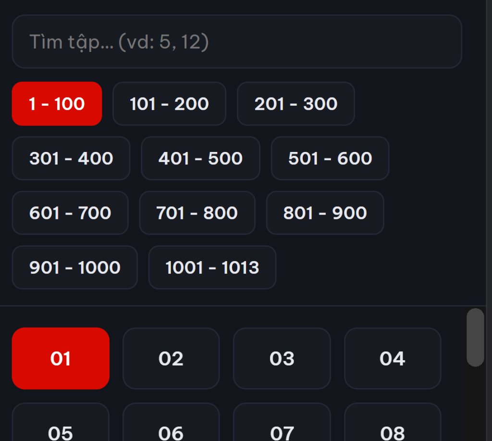
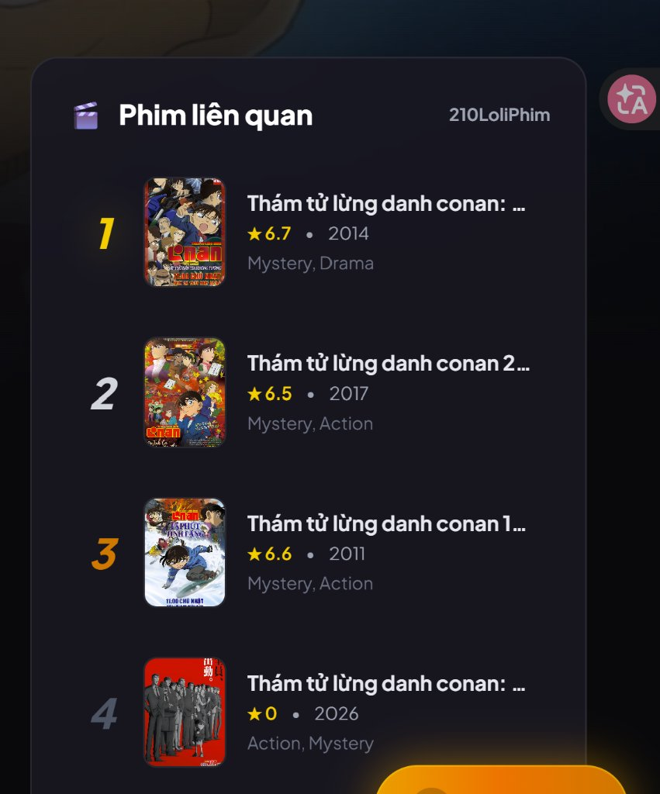

# CineSmart (210LoliPhim)

Nền tảng xem Anime & Hoạt hình trực tuyến xây dựng bằng **React + Vite + Tailwind CSS**, phát luồng HLS (`.m3u8`) qua **Artplayer + Hls.js**, lưu trữ dữ liệu trên **Cloud Firestore**, tích hợp trợ lý AI **Gemini**, và tự động đồng bộ phim mới hằng ngày qua **GitHub Actions**.

---

## Giao diện ứng dụng

### Trang Xem Phim & Trình phát Video


### Bộ lọc Anime Season & Kho Phim theo Thể loại


| Chọn Đa Thể Loại (78 tag MyAnimeList) | Gom nhóm 100 tập & Tìm tập | Phim Liên Quan |
| :---: | :---: | :---: |
|  |  |  |

---

## Tính năng nổi bật

- **Trình phát Video tối ưu cho Anime (`Artplayer + Hls.js`):**
  - Bố cục 2 cột gọn gàng (trình phát ở bên trái, danh sách **Phim liên quan** ở bên phải).
  - Nút tua **`+1'30s`** (90 giây) để bỏ qua Intro/Opening trên thanh điều khiển; phím tắt **`>`** hoặc **`→`** tua **`+10s`**.
  - Nút **Lùi lại tập trước** & **Qua tập tiếp theo** nằm ngay cạnh nút chụp ảnh màn hình.
  - Tự động lưu vị trí đang xem và gợi ý **Tiếp tục xem** khi mở lại phim.
- **Quản lý tập & Đa nguồn phát:**
  - Tự động cào và hợp nhất nhiều server phát (**Vietsub**, **Lồng Tiếng**, **Thuyết Minh**) kèm nút chuyển đổi ngay trên danh sách tập (tự khóa ở chế độ hiển thị nếu phim chỉ có 1 bản).
  - Gom nhóm mỗi **100 tập** và ô **Tìm tập nhanh** cho các bộ dài tập.
- **Bộ lọc chuẩn MyAnimeList & Anime Season:**
  - Danh mục **78 thể loại chuẩn MyAnimeList** kèm chú thích ngắn gọn tiếng Việt cho từng thể loại.
  - Lọc theo **Anime Season Nhật Bản** (Mùa Đông: T1–T3, Mùa Xuân: T4–T6, Mùa Hạ: T7–T9, Mùa Thu: T10–T12) và **Movie**.
  - Sắp xếp mặc định theo **Năm phát hành mới nhất**, hỗ trợ điểm IMDb và tên A–Z (lưu trạng thái trực tiếp trên URL).
- **Trợ lý AI & Trang quản trị Admin (`/admin`):**
  - Chatbox AI (Gemini API) gợi ý phim dựa trên dữ liệu thực tế trong kho.
  - Quản lý phim (CRUD), **Magic Import**, bình luận cộng đồng, và nút chuẩn hóa thể loại từ MyAnimeList/AniList.
- **Bot đồng bộ phim tự động (`.github/workflows/daily-anime-crawler.yml`):**
  - Tự động chạy hằng ngày trên Node.js 22: lấy phim mới cập nhật từ trang 1 **Hoạt hình Nhật Bản** và trang 1 **Hoạt hình Trung Quốc** (PhimAPI/KKPhim), ánh xạ thể loại & mùa phát sóng từ **MyAnimeList (Jikan API)** / **AniList GraphQL**, sau đó cập nhật lên Firestore qua Firebase Admin SDK.

---

## Công nghệ sử dụng

- **Frontend:** React 18, Vite 5, React Router 6, Tailwind CSS 3, Lucide Icons
- **Media Player:** Artplayer, HLS.js
- **Backend / Serverless & Database:** Vercel Serverless Functions (`api/`), Firebase Auth & Cloud Firestore, Firebase Admin SDK
- **Automation & Testing:** GitHub Actions, Node.js 22 (`node --test`), ESLint

---

## Cấu trúc thư mục

```text
CineSmart/
├── api/                    # Vercel Serverless Functions (admin login, crawl, chat, comments)
├── server/                 # Logic xử lý phía server dùng chung cho API & test
├── scripts/                # Bot cào phim hằng ngày, kiểm tra nguồn & đồng bộ thể loại MAL
│   ├── lib/                # Adapter PhimAPI, Jikan/AniList lookup, Firestore store & recovery
│   └── ANIME_CRAWLER.md    # Tài liệu vận hành chi tiết cho daily anime crawler
├── src/
│   ├── components/         # Navbar, VideoPlayer, EpisodeSelector, RelatedMoviesSidebar, Admin...
│   ├── contexts/           # AuthContext
│   ├── pages/              # HomePage, CategoryPage, DetailFilm, WatchPage, AdminDashboard...
│   ├── services/           # Giao tiếp Firebase, tương tác, lịch sử xem, PhimAPI import
│   └── utils/              # Chuẩn hóa dữ liệu phim, danh mục thể loại MAL, định dạng thời lượng
├── tests/                  # Bộ kiểm thử tự động (node --test)
├── .github/workflows/      # Workflow chạy bot tự động hằng ngày
└── vercel.json             # Cấu hình build & serverless functions trên Vercel
```

---

## Hướng dẫn cài đặt & chạy Local

### Yêu cầu
- **Node.js 22.x** và `npm`

### 1. Cài đặt dependencies
```bash
npm ci
```

### 2. Cấu hình biến môi trường
Sao chép file mẫu `.env.example` thành `.env` và điền thông tin Firebase / API key của bạn:
```bash
cp .env.example .env
```

Các biến môi trường quan trọng:
- `VITE_FIREBASE_*`: Cấu hình Firebase Web SDK (Frontend).
- `GEMINI_API_KEY`: API key Google Gemini cho tính năng Chat AI.
- `FIREBASE_SERVICE_ACCOUNT_JSON` *(tùy chọn ở local)*: Nội dung chuỗi JSON của Firebase Admin Service Account (cần khi chạy API `/api/admin/*`, `npm run crawl:anime` hoặc `npm run sync:mal-genres`).

### 3. Các lệnh thường dùng
```bash
# Chạy giao diện dev (http://localhost:3000)
npm run dev

# Kiểm tra lint
npm run lint

# Chạy toàn bộ bộ test
npm run test:crawler

# Build production (thư mục dist/)
npm run build
```

---

## Vận hành Bot Crawler & Deploy

### Bot đồng bộ phim & thể loại MyAnimeList
Xem hướng dẫn chi tiết tại [`scripts/ANIME_CRAWLER.md`](scripts/ANIME_CRAWLER.md). Một số lệnh CLI chính:

```bash
# Kiểm tra nguồn PhimAPI (không cần Firebase credential)
npm run check:anime-source

# Chạy thử bot cào ở chế độ dry-run (không ghi DB)
npm run crawl:anime -- --dry-run

# Đồng bộ thể loại & Anime Season cho toàn bộ phim hiện có trong Firestore
npm run sync:mal-genres            # xem trước (dry-run)
npm run sync:mal-genres -- --apply # ghi trực tiếp lên Firestore
```

### Deploy lên Vercel & GitHub Actions
1. **Vercel:** Kết nối repository với Vercel (cấu hình sẵn trong [`vercel.json`](vercel.json)), thiết lập các biến môi trường `FIREBASE_SERVICE_ACCOUNT_JSON` và `GEMINI_API_KEY` trong **Project Settings → Environment Variables**. Mỗi lần push lên nhánh `main`, Vercel sẽ tự động build và deploy.
2. **GitHub Actions:** Trong **Settings → Secrets and variables → Actions** của repository:
   - Secret `FIREBASE_SERVICE_ACCOUNT_JSON`: JSON key của Service Account.
   - Variable `FIREBASE_PROJECT_ID`: `loliphim-db` (hoặc project ID đang deploy).
   - Variable `CRAWLER_WRITES_ENABLED`: đặt `true` khi cho phép bot tự động ghi dữ liệu mới lên Firestore.
